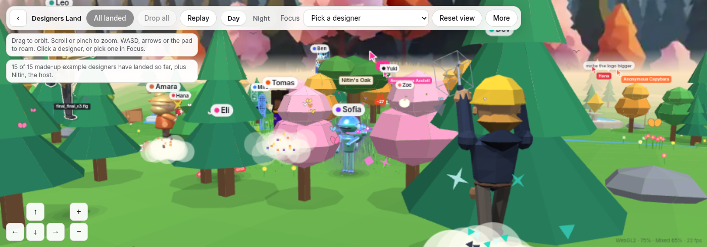
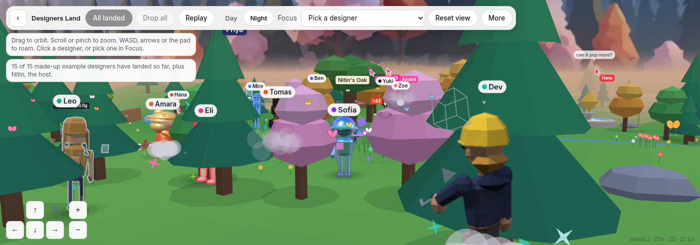
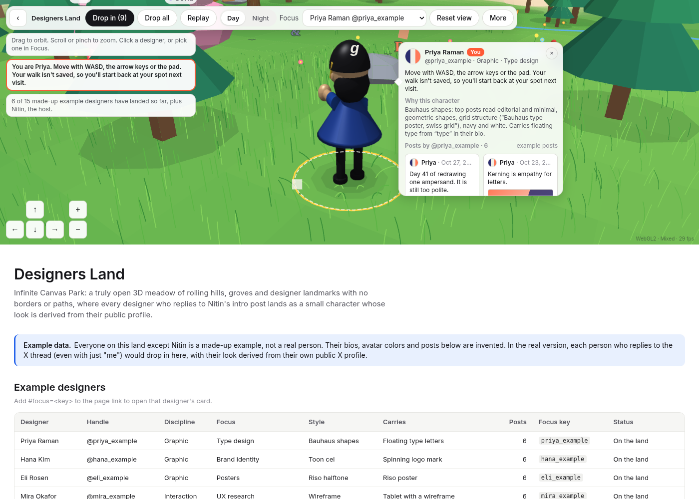

<h1 align="center">Designers Land</h1>

<p align="center">A chill open-world park for designers on X.</p>

<p align="center">
  <a href="https://sauronnitin.github.io/designers-land/"></a>
  &nbsp;
  <a href="https://x.com/nitin_sauran"></a>
  &nbsp;
  
  &nbsp;
  
</p>

<p align="center">
  <a href="https://sauronnitin.github.io/designers-land/"></a>
</p>

## 🌤️ Day and night

<table>
  <tr>
    <td width="50%"></td>
    <td width="50%"></td>
  </tr>
  <tr>
    <td align="center"><sub>Day</sub></td>
    <td align="center"><sub>Night</sub></td>
  </tr>
</table>

## 🌿 What is this

Every designer who replies to Nitin's intro post on X lands in an endless open-world meadow as a unique 3D character, styled from their public profile.

The 15 designers currently shown are made-up examples. Nitin is the host.

## 💬 How to join

Reply to [@nitin_sauran](https://x.com/nitin_sauran)'s intro post on X. Real designers with design work on their timeline get added and receive their personal link.

<p align="center">
  
</p>

<p align="center"><sub>A personal visit. The designers in this shot are examples.</sub></p>

## 🕹️ Controls

| | |
| --- | --- |
| Orbit | Drag |
| Zoom | Scroll or pinch |
| Move the camera | WASD, the arrow keys, or the on-screen pad |
| Open a designer | Click them, or pick one in Focus, to open their card |
| Landmark jokes | Click the fountain, Nitin's Oak, the Undo Pond, or Comic Sans Jail |
| Day / Night | Toggle in the top bar |
| Quality | Under More |
| Your own character | Open your personal `#me=` link and walk with WASD. Press F or Space to interact. Nothing is saved. |

## 🌸 Things to play with

- Fountain splash
- Ducks
- Butterflies
- Flowers to bloom and pick
- Birds
- Stone skipping
- Sitting
- Bouncy blankets
- The swing on Nitin's Oak
- Crit notes

## ⚙️ Under the hood

- Static `index.html` and `bundle.js`. No build step.
- Custom WebGL2 renderer with 3D/Mixed/2D adaptive modes and a software fallback.
- AI-generated 360 sky panorama, embedded in the bundle. `sky/` holds the source images.
- `.nojekyll` is included so GitHub Pages serves the files as they are.

## 💻 Run locally

Any static server will do. From the repo root:

```bash
npx serve .
```

or

```bash
python3 -m http.server
```

Open the address the server prints.

## ☀️ Credits

Designers Land is by [@nitin_sauran](https://x.com/nitin_sauran).

The park is live at [sauronnitin.github.io/designers-land](https://sauronnitin.github.io/designers-land/).
